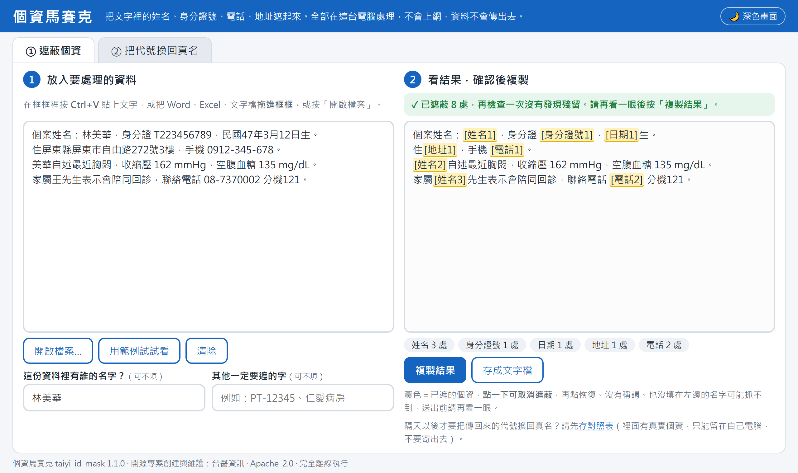
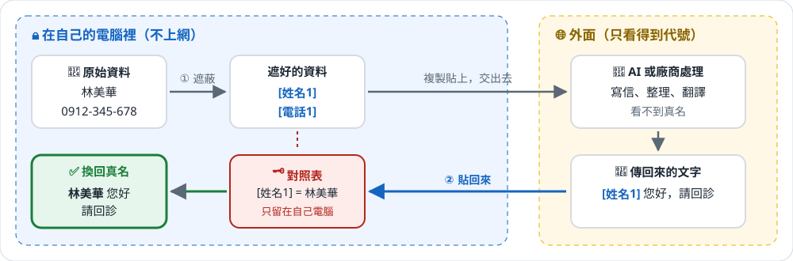
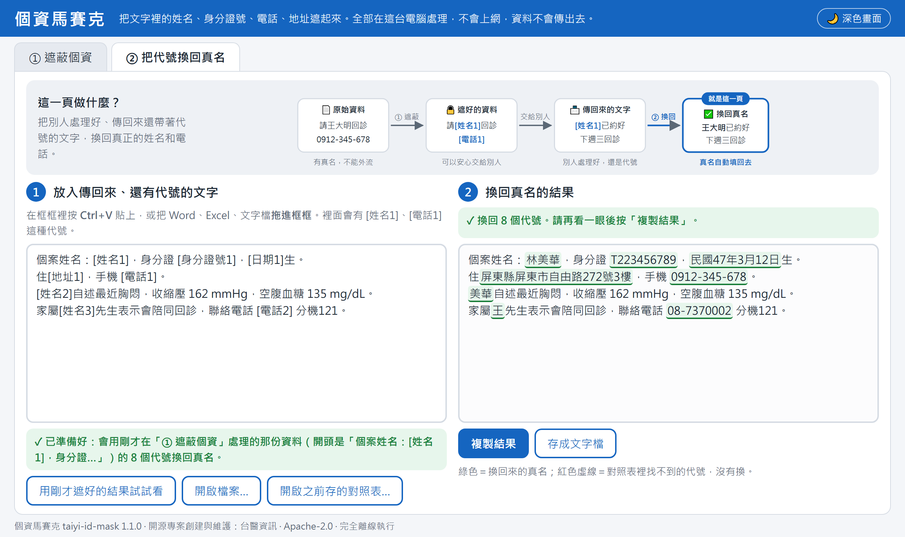
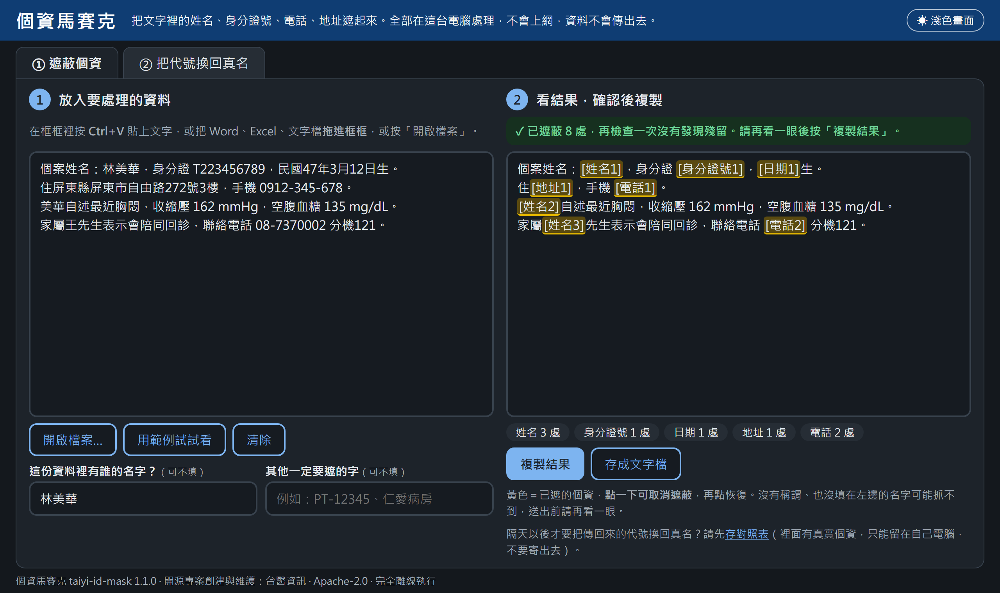

# taiyi-id-mask 個資馬賽克

**[下載個資馬賽克（zip 整包，免安裝）](https://github.com/taiyisystems/taiyi-id-mask/releases/latest/download/taiyi-id-mask-web.zip)**　解壓後雙擊「個資馬賽克.html」就能用　｜　[線上試用](https://taiyisystems.github.io/taiyi-id-mask/)

繁體中文（台灣）文字的個資偵測與遮蔽。資料要交給外部服務、分析程式或語言模型之前，先在本機把姓名、身分證號、電話、地址等換成代號，回覆再換回原值。



- 只用 Python 標準函式庫，Python 3.8 以上，沒有相依套件。
- 全部在本機執行，不連網路。
- Apache-2.0 授權。

[English summary](#english)

## 一張圖看懂



對照表（哪個代號是誰）只留在自己電腦。交出去的只有代號，對方看不到真名；拿回來的文字只要保留代號，就能換回真名。

## 不會寫程式？直接用網頁版

**線上試用（不用下載）：<https://taiyisystems.github.io/taiyi-id-mask/>**　網頁在你自己的瀏覽器裡處理，頁面設定禁止任何網路連線，資料不會傳出去。

要在沒有網路的電腦上用，或公司規定資料不能開網頁處理：

1. 點 **[下載個資馬賽克（zip 整包）](https://github.com/taiyisystems/taiyi-id-mask/releases/latest/download/taiyi-id-mask-web.zip)**，在下載的檔案上按右鍵「解壓縮全部」。
2. 打開解壓出來的「個資馬賽克」資料夾，雙擊「個資馬賽克.html」（Edge、Chrome 都可以）。資料夾裡還有使用說明和範例檔案。
3. 把文字貼進去，或把 Word、Excel、文字檔拖進去，右邊就會出現遮好的結果，按「複製結果」。
4. 別人處理好、傳回來的文字還有 `[姓名1]` 這種代號時，到「② 把代號換回真名」貼上或把檔案拖進去，就會換回真名。隔天以後才要換的，要先存對照表：按「複製結果」或「存成檔案」後，畫面會提醒並提供「存對照表」按鈕；之後在 ② 開啟它。

全部在自己電腦處理，網頁設定禁止連網，資料不會傳出去。第一次用可以按「用範例試試看」，或把 [`examples/`](examples/) 裡的範例檔（Word、Excel、CSV、文字檔，全部是虛構資料）拖進去。

「② 把代號換回真名」：換回來的真名標綠色，對照表裡找不到的代號標紅色虛線。



<details>
<summary>深色畫面（右上角按鈕切換）</summary>



</details>

## 三層做法

| 層 | 函式 | 做什麼 |
|---|---|---|
| 1. 欄位白名單 | `minimize_record(record, allowed)` | 結構化資料只留需要的欄位；出生日期換成 5 歲一級的年齡層，90 歲以上合併 |
| 2. 文字遮蔽 | `mask(text, known, extra)` | 疑似個資換成 `[姓名1]` 這類代號；同一個值用同一個代號 |
| 3. 送出前檢查 | `guard(text, known, extra)` | 遮蔽後再掃一次，還有殘留就丟 `PIIBlocked`，呼叫端不得送出 |

`unmask(text, mapping)` 把回覆裡的代號換回原值；全形括號（`［姓名1］`、`【姓名1】`）和括號內的空白也認得，對照表裡沒有的代號原樣保留。`mapping` 只能留在本機。

## 安裝與使用

不寫程式的人不用安裝：**[下載個資馬賽克（zip 整包）](https://github.com/taiyisystems/taiyi-id-mask/releases/latest/download/taiyi-id-mask-web.zip)**，解壓後雙擊「個資馬賽克.html」。

給 Python 程式使用（Python 3.8 以上）：

```bash
pip install https://github.com/taiyisystems/taiyi-id-mask/archive/refs/tags/v1.1.0.zip
```

```python
import taiyi_id_mask as idmask

rec = {'name': '林美華', 'id_no': 'T223456789', 'birth_date': '1958-03-12', 'sex': '女', 'sbp': 162}
note = '林美華自述胸悶，家住屏東縣屏東市自由路272號，電話 0912-345-678。'

known = {'姓名': [rec['name']], '身分證號': [rec['id_no']]}
r = idmask.guard(note, known)            # 有殘留會丟 PIIBlocked
payload = {**idmask.minimize_record(rec, ['sex', 'sbp', 'age_band']), 'note': r.text}
# payload['note']：'[姓名1]自述胸悶，家住[地址1]，電話 [電話1]。'
reply = '...'                         # 外部服務的回覆
print(idmask.unmask(reply, r.mapping))   # 代號換回原值
```

醫院自己的病歷號格式可以用 `extra` 加入：

```python
idmask.mask(text, extra=[('病歷號', r'PT-\d{5}')])
```

命令列：

```bash
taiyi-id-mask note.txt --known known.json --strict
```

```bash
taiyi-id-mask note.txt --json
```

## 偵測項目

| 類別 | 規則 |
|---|---|
| 已知值 | `known` 傳入的姓名、證號、電話、地址等，原樣出現就遮；三字以上的姓名，只寫名字也遮。**最可靠，建議一定要用** |
| 身分證號 | 1 碼英文加 9 碼數字（國民身分證、新式外來人口統一證號）；2 碼英文加 8 碼數字（舊式居留證）。只比對格式，不驗檢查碼 |
| 電話 | 手機、市話（含分機）、+886 開頭 |
| 電子郵件 | 一般格式 |
| 日期 | 西元或民國的完整年月日 |
| 地址 | 縣市或鄉鎮市區名稱開頭，後面接村里、鄰、路街段、巷、弄、號、樓 |
| 長串數字 | 8 碼以上，例如病歷號、健保卡號 |
| 標籤個資 | 「姓名：」「病歷號：」「地址：」「生日：」等標籤後面的值 |
| 姓名 | 「姓名：陳小明」這類標籤，以及「王先生」「陳小姐」這類稱謂前的名字（「家屬王先生」「病人陳小姐」前面的身分詞不算名字） |

血壓、血糖、HbA1c、BMI、eGFR 這類檢驗數值不會被遮，有測試確認。

## 限制

- 沒有標籤、沒有稱謂、也不在已知值裡的人名偵測不到，例如「跟小明一起來」。自由文字一定要搭配已知值，而且只送真正需要的欄位。
- 只寫「中山路 5 號」、沒有縣市鄉鎮的地址抓不到。
- 設計上寧可多遮：「東區」這類名稱後面剛好接到「路」「里」等字，可能被當成地址。
- 這是降低風險的工具，不保證完全去識別化。資料能不能送出，仍要依法令與資料提供者的規定判斷。

## 資料來源

縣市與鄉鎮市區名稱表 `src/taiyi_id_mask/data/tw_place_names.json`：
- 來源：內政部國土測繪中心「鄉鎮市區界線(TWD97經緯度)」1140318 版（https://data.gov.tw/dataset/7441）。
- 授權：政府資料開放授權條款第 1 版。
- 改版時用 `python scripts/build_place_names.py <下載的 zip>` 重建。

## 開發

```bash
python -m unittest discover -s tests -v
```

網頁版的偵測規則在 `app/engine.js`，必須和 `src/taiyi_id_mask/core.py` 一致；改了任一邊都要同步，並重新產生成品：

```bash
python scripts/build_app.py
```

`tests/test_app.py` 會用 Node.js 逐例比對兩邊結果，並檢查成品是不是最新的。

修改規則請一併加測試（見 CONTRIBUTING.md）。測試資料一律使用虛構資料。

範例檔與 README 截圖都由程式產生，改了網頁後重跑（截圖需要本機有 Edge 或 Chrome）：

```bash
python scripts/build_examples.py
```

```bash
python scripts/make_screenshots.py
```

線上試用版由 `.github/workflows/pages.yml` 發布到 GitHub Pages。推上 `v1.0.0` 這類 tag 時，`.github/workflows/release.yml` 會測試、確認版本號一致，再建立 GitHub Release 並附上 `scripts/build_release.py` 產生的下載整包。

## English

[Download the web app (zip, no installation)](https://github.com/taiyisystems/taiyi-id-mask/releases/latest/download/taiyi-id-mask-web.zip) — unzip and double-click `個資馬賽克.html`. Or try it online: <https://taiyisystems.github.io/taiyi-id-mask/> (runs entirely in your browser; the page forbids all network connections). Python: `pip install https://github.com/taiyisystems/taiyi-id-mask/archive/refs/tags/v1.1.0.zip`.

**taiyi-id-mask** detects and masks personal data in Traditional Chinese (Taiwan) text before it leaves your machine. Examples include names, national ID / resident certificate numbers, phone numbers, e-mail addresses, dates, Taiwanese street addresses and long record numbers. It replaces each value with a stable token such as `[姓名1]` and can restore the values afterwards.

It works in three layers:
- `minimize_record` keeps only the fields you allow and turns birth dates into age bands.
- `mask` replaces detected values with tokens; `unmask` restores them (also accepting full-width brackets such as `［姓名1］` and leaving unknown tokens untouched).
- `guard` re-scans the masked text and raises `PIIBlocked` if anything suspicious remains.

The package is pure standard-library Python 3.8+, runs fully offline, and is licensed under Apache-2.0. Place names come from the Ministry of the Interior open dataset (Open Government Data License v1); see NOTICE.

It reduces risk but does not guarantee anonymisation. Always pass known identifiers (`known=`) and send only the fields you need.
